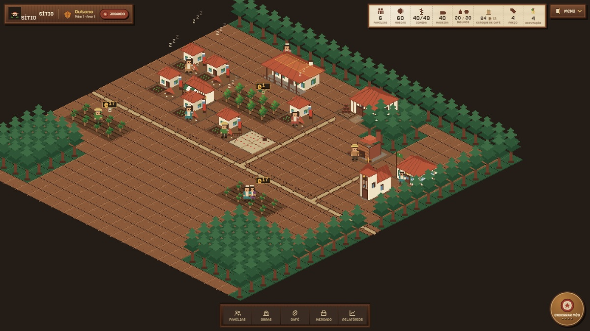
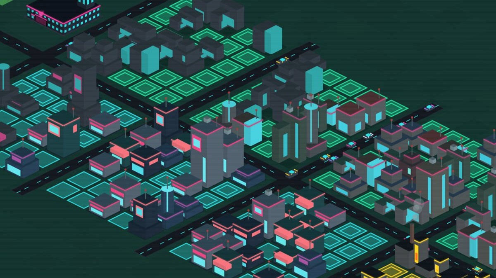
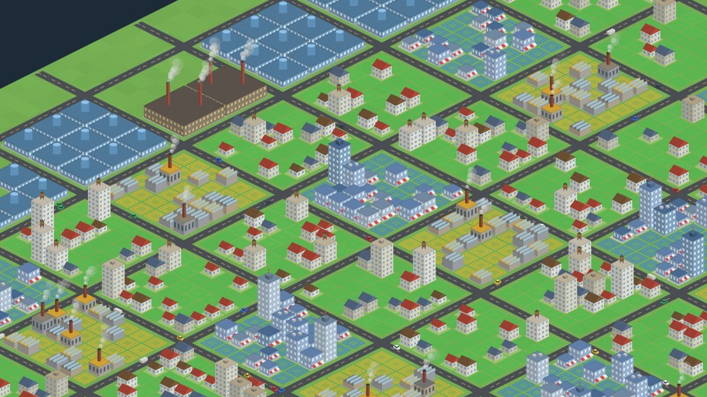

<p align="center">
  <a href="https://gamestudio42.github.io/">
    
  </a>
</p>

<h1 align="center">Game Studio 42</h1>

<p align="center"><strong>Open-source games. Play anywhere. Fork everything.</strong></p>

<p align="center">
  Cities that come alive. Worlds you make your own.<br>
  Independent open-source games for curious players and people who love to build —<br>
  play many in one click in the browser, install desktop builds from the Snap Store where available, with mobile on the roadmap.
</p>

<p align="center">
  <a href="https://gamestudio42.github.io/"></a>
  &nbsp;
  <a href="https://github.com/orgs/gamestudio42/repositories"></a>
</p>

<p align="center">
  <strong>Free to play · Browser &amp; desktop · Open source</strong><br>
  <sub><a href="https://gamestudio42.github.io/pt/">Português</a> · <a href="https://gamestudio42.github.io/es/">Español</a> · <a href="https://gamestudio42.github.io/fr/">Français</a> · <a href="https://gamestudio42.github.io/de/">Deutsch</a></sub>
</p>

<p align="center">
  <strong>Your project can grow with the Game Studio 42 community.</strong><br>
  Bring your open-source game, engine, library, SDK, development tool or AI agent for games.<br>
  <a href="https://github.com/gamestudio42/.github/issues/new?template=project-submission.yml"></a><br>
  <sub>Shared maintenance or community adoption · Any engine or platform · English or Portuguese welcome</sub>
</p>

---

## Find your next world

Grow a coffee farm into a village, hold a city against the horde, march one column across a country, scavenge a street before night, fly a ship that keeps its speed, plan a new district, keep the neon alive, follow a wandering spring or build an adventure one block at a time. Pick a world and start playing.

### Vazante — Hold the city. Take the rifle.

Command squads through Porto Velário, keep supply trucks moving and fortify your base against the infected. Switch from tactical command to direct third-person control of a soldier without leaving the battle.

<a href="https://gamestudio42.github.io/vazante/">
  
</a>

**Real-time tactics · Supply routes & fortifications · Direct soldier control**

[**Play Vazante →**](https://gamestudio42.github.io/vazante/) · [Source code](https://github.com/gamestudio42/vazante)

Interface in Portuguese, English, Spanish, French and German. Seven campaign missions, and survival on the map of Porto Velário.

### Sítio — The farm that becomes a village.

Grow coffee, organize family work and turn a small farm into a community. Plan each month, tend your harvests and build what lasts.

<a href="https://gamestudio42.github.io/sitio/">
  
</a>

**Farm management · Coffee production · Families & village life**

[**Play Sítio →**](https://gamestudio42.github.io/sitio/) · [Source code](https://github.com/gamestudio42/sitio)

English, Portuguese, Spanish, French and German interface. Game code: AGPL-3.0-or-later; reusable libraries: Apache-2.0; art and documentation: CC-BY-4.0. See [Sítio licensing](https://github.com/gamestudio42/sitio/blob/main/LICENSING.md) for the complete breakdown.

<!-- Shared rows keep screenshots and play links aligned when taglines wrap. -->
<table>
<tr>
<td width="50%" valign="top">

<h3><a href="https://github.com/gamestudio42/urbe-oasis">Urbe Oasis</a></h3>
<p><strong>A little water. A whole world.</strong></p>

</td>
<td width="50%" valign="top">

<h3><a href="https://github.com/gamestudio42/neo-urbe">Neo Urbe</a></h3>
<p><strong>Raise a neon skyline. Keep the grid alive.</strong></p>

</td>
</tr>
<tr>
<td width="50%" valign="top">

<a href="https://gamestudio42.github.io/urbe-oasis/">
  
</a>
<p>Found an adobe city beside a wandering spring. Bring water and shade to its districts, trade with caravans and adapt to sandstorms.</p>

</td>
<td width="50%" valign="top">

<a href="https://gamestudio42.github.io/neo-urbe/">
  
</a>
<p>Build under pressure from an unstable grid, megacorporations and hackers. Connect the city, grow its skyline and keep its networks running.</p>

</td>
</tr>
<tr>
<td width="50%" valign="top">

<p><a href="https://gamestudio42.github.io/urbe-oasis/"><strong>Enter the oasis →</strong></a> &nbsp;·&nbsp; <a href="https://github.com/gamestudio42/urbe-oasis">Source code</a></p>

</td>
<td width="50%" valign="top">

<p><a href="https://gamestudio42.github.io/neo-urbe/"><strong>Play Neo Urbe →</strong></a> &nbsp;·&nbsp; <a href="https://github.com/gamestudio42/neo-urbe">Source code</a></p>

</td>
</tr>
<tr>
<td width="50%" valign="top">

<h3><a href="https://github.com/gamestudio42/urbe">Urbe</a></h3>
<p><strong>You set the conditions. The city decides the rest.</strong></p>

</td>
<td width="50%" valign="top">

<h3><a href="https://github.com/gamestudio42/mineboss">MineBoss</a></h3>
<p><strong>Build, explore and fight — when you want to.</strong></p>

</td>
</tr>
<tr>
<td width="50%" valign="top">

<a href="https://gamestudio42.github.io/urbe/">
  
</a>
<p>Lay roads, zone districts and keep power and water flowing. Watch demand, traffic and disasters shape the city you started.</p>

</td>
<td width="50%" valign="top">

<a href="https://gamestudio42.github.io/mineboss/">
  
</a>
<p>Explore a voxel world in Adventure or OneBlock mode. Build freely, craft your next tool and seek out optional bosses when you're ready.</p>

</td>
</tr>
<tr>
<td width="50%" valign="top">

<p><a href="https://gamestudio42.github.io/urbe/"><strong>Play Urbe →</strong></a> &nbsp;·&nbsp; <a href="https://github.com/gamestudio42/urbe">Source code</a></p>

</td>
<td width="50%" valign="top">

<p><a href="https://gamestudio42.github.io/mineboss/"><strong>Play MineBoss →</strong></a> &nbsp;·&nbsp; <a href="https://github.com/gamestudio42/mineboss">Source code</a></p>

</td>
</tr>
</table>

<sub>Real gameplay from the projects. Sítio, Urbe, Neo Urbe, Urbe Oasis and Vazante support English, Portuguese, Spanish, French and German. MineBoss currently has a Portuguese player interface.</sub>

### Prestes — One column against a whole country.

Build your sections from period rosters, deploy them on hand-drawn battlefields and fight for the objectives under fog of war. The campaign follows the Coluna Prestes from 1922 to 1927.

<a href="https://gamestudio42.github.io/prestes/">
  
</a>

**Historical real-time tactics · Deploy, then fight · Map editor**

[**Play Prestes →**](https://gamestudio42.github.io/prestes/) · [Source code](https://github.com/gamestudio42/prestes)

Portuguese and English interface. Eight campaign chapters, opened in order, and skirmish.

<table>
<tr>
<td width="50%" valign="top">

<h3><a href="https://github.com/gamestudio42/dead-sector">Dead Sector</a></h3>
<p><strong>Every shot is heard. Every order has a price.</strong></p>

</td>
<td width="50%" valign="top">

<h3><a href="https://github.com/gamestudio42/afterfall">Afterfall</a></h3>
<p><strong>Scavenge by day. Hold by night. Rebuild the world.</strong></p>

</td>
</tr>
<tr>
<td width="50%" valign="top">

<a href="https://gamestudio42.github.io/dead-sector/">
  
</a>
<p>Command two squads through a zombie outbreak. Survivors act on their own under threat, and the infected react only to what they see and hear, so every gunshot can bring the neighbourhood down on you.</p>

</td>
<td width="50%" valign="top">

<a href="https://gamestudio42.github.io/afterfall/">
  
</a>
<p>Lead a handful of survivors in a city emptied by an outbreak. Scavenge by day, fortify before night, and play on a generated city or on real streets from OpenStreetMap.</p>

</td>
</tr>
<tr>
<td width="50%" valign="top">

<p><a href="https://gamestudio42.github.io/dead-sector/"><strong>Play Dead Sector →</strong></a> &nbsp;·&nbsp; <a href="https://github.com/gamestudio42/dead-sector">Source code</a></p>

</td>
<td width="50%" valign="top">

<p><a href="https://gamestudio42.github.io/afterfall/"><strong>Play Afterfall →</strong></a> &nbsp;·&nbsp; <a href="https://github.com/gamestudio42/afterfall">Source code</a></p>

</td>
</tr>
<tr>
<td width="50%" valign="top">

<h3><a href="https://github.com/gamestudio42/void-frontier">Void Frontier</a></h3>
<p><strong>No friction. No brakes you didn't fire yourself.</strong></p>

</td>
<td width="50%" valign="top">

<h3><a href="https://github.com/gamestudio42/void-dominion">Void Dominion</a></h3>
<p><strong>Every order is checked. Every match replays exactly.</strong></p>

</td>
</tr>
<tr>
<td width="50%" valign="top">

<a href="https://gamestudio42.github.io/void-frontier/">
  
</a>
<p>Fly a working ship with Newtonian physics: let go of the throttle and you keep your speed. Mine, trade, take contracts, fight pirates and dock to repair and refit.</p>

</td>
<td width="50%" valign="top">

<a href="https://gamestudio42.github.io/void-dominion/">
  
</a>
<p>Command the Helion Directorate against General Varek. Engineers mine, the command card builds and trains, and fog hides the enemy base until you have seen it. A refused order names its reason and spends nothing.</p>

</td>
</tr>
<tr>
<td width="50%" valign="top">

<p><a href="https://gamestudio42.github.io/void-frontier/"><strong>Play Void Frontier →</strong></a> &nbsp;·&nbsp; <a href="https://github.com/gamestudio42/void-frontier">Source code</a></p>

</td>
<td width="50%" valign="top">

<p><a href="https://gamestudio42.github.io/void-dominion/"><strong>Play Void Dominion →</strong></a> &nbsp;·&nbsp; <a href="https://github.com/gamestudio42/void-dominion">Source code</a></p>

</td>
</tr>
<tr>
<td width="50%" valign="top">

<h3><a href="https://github.com/gamestudio42/ascii-racing">ASCII Racing</a></h3>
<p><strong>Every pixel is a character.</strong></p>

</td>
<td width="50%" valign="top">

<h3><a href="https://github.com/gamestudio42/noosphere">Noosphere</a></h3>
<p><strong>An ecosystem of living ideas.</strong></p>

</td>
</tr>
<tr>
<td width="50%" valign="top">

<a href="https://gamestudio42.github.io/ascii-racing/">
  
</a>
<p>Race three rivals over three laps. Missiles, mines, nitro and repairs are on the track, and every car, kerb and wall is drawn with text characters.</p>

</td>
<td width="50%" valign="top">

<a href="https://gamestudio42.github.io/noosphere/">
  
</a>
<p>Plant ideas and keep them alive with attention. Neighbouring thoughts bond, different archetypes merge into hybrids, and doubts drift in while focus runs out.</p>

</td>
</tr>
<tr>
<td width="50%" valign="top">

<p><a href="https://gamestudio42.github.io/ascii-racing/"><strong>Play ASCII Racing →</strong></a> &nbsp;·&nbsp; <a href="https://github.com/gamestudio42/ascii-racing">Source code</a></p>

</td>
<td width="50%" valign="top">

<p><a href="https://gamestudio42.github.io/noosphere/"><strong>Play Noosphere →</strong></a> &nbsp;·&nbsp; <a href="https://github.com/gamestudio42/noosphere">Source code</a></p>

</td>
</tr>
</table>

<sub>Dead Sector uses a Portuguese interface. Afterfall opens in Portuguese and also offers English from the main menu. Void Frontier and Void Dominion follow the browser between Portuguese and English. ASCII Racing supports English, Portuguese, Spanish, French and German. Noosphere is in English.</sub>

### Coelhinho Craft Pintar — Paint, build, and play with a bunny.

A peaceful block world in the browser. Paint pixel art on the walls, place and remove blocks, and give carrots to a white bunny that follows you from the start. There are no monsters, no fights and no scares. The words on screen are simple Brazilian Portuguese.

[**Play Coelhinho Craft Pintar →**](https://gamestudio42.github.io/coelhinho-craft-pintar/) · [Source code](https://github.com/gamestudio42/coelhinho-craft-pintar)

### More room to experiment: Plot 42

[**Plot 42**](https://github.com/gamestudio42/plot42) is a store-style lobby plus three small browser games:

- **Horta** — plant, wait and harvest on a small isometric grid.
- **Posto** — three units on a 10×10 board. Move, attack, then the enemy answers.
- **Mata** — restore a scar before the drought. Seeds and the cistern are limited.

The lobby links out to the standalone Urbe, Neo Urbe, Urbe Oasis, Vazante and Sítio sites. Horta, Posto and Mata run on this site, in English, Portuguese, Spanish, French and German.

[**Explore Plot 42 →**](https://gamestudio42.github.io/plot42/) · [Source code](https://github.com/gamestudio42/plot42)

### Make a game

<table>
<tr>
<td width="50%" valign="top">

<h3><a href="https://github.com/gamestudio42/gamestudio-kids">Game Studio Kids</a></h3>
<p><strong>Draw it. Build it. Play it.</strong></p>

</td>
<td width="50%" valign="top">

<h3><a href="https://github.com/gamestudio42/gamestudio-teens">Game Studio Teen</a></h3>
<p><strong>Draw the actors. Write the rules. Ship the game.</strong></p>

</td>
</tr>
<tr>
<td width="50%" valign="top">

<a href="https://gamestudio42.github.io/gamestudio-kids/">
  
</a>
<p>A 2D game maker for children aged five and up. Paint pixel-art characters, place them on a level and play the game you made. Pixo guides the first game and reads every instruction aloud.</p>

</td>
<td width="50%" valign="top">

<a href="https://gamestudio42.github.io/gamestudio-teens/">
  
</a>
<p>A 2D game maker for readers aged about ten to fifteen. Each actor has its own pixel art and rules. Build levels, test them in a debugger, read the rules as code and export one HTML file.</p>

</td>
</tr>
<tr>
<td width="50%" valign="top">

<p><a href="https://gamestudio42.github.io/gamestudio-kids/"><strong>Open Game Studio Kids →</strong></a> &nbsp;·&nbsp; <a href="https://github.com/gamestudio42/gamestudio-kids">Source code</a></p>

</td>
<td width="50%" valign="top">

<p><a href="https://gamestudio42.github.io/gamestudio-teens/"><strong>Open Game Studio Teen →</strong></a> &nbsp;·&nbsp; <a href="https://github.com/gamestudio42/gamestudio-teens">Source code</a></p>

</td>
</tr>
</table>

<sub>Both makers are plain JavaScript, with a Brazilian Portuguese interface. Kids projects use <code>.gsk</code> files. Teen projects use <code>.gst</code> files.</sub>

---

## Made to play. Open to possibility.

We build games around systems you can explore: a coffee farm becoming a village, a growing city, a fragile water supply, a world made of blocks, a city held together by squads and supply lines, a neighbourhood that hears every shot, a colony that scavenges by day, a ship that only slows when a thruster fires, a column that pays for every order with a march. The same curiosity that makes them fun to play makes them interesting to take apart.

- **Start with a browser tab.** The featured games are free to play, with no installation required.
- **Look inside.** Each featured game has public source code under its own license; check its repository for code, asset and dependency terms. Read how a mechanic works, change the rules or build your own variation.
- **Build in the open.** Follow commits, report what you find and help shape the next change.

Most featured games use **TypeScript**. **PixiJS** draws Sítio and the Urbe games. **Three.js** draws MineBoss, Vazante, Afterfall, Void Frontier, Void Dominion, Coelhinho Craft Pintar and Prestes. Dead Sector uses **Phaser**. Noosphere is **React** and a canvas. ASCII Racing, Game Studio Kids and Game Studio Teen are plain **JavaScript**, with no build step. Sítio, Vazante and Prestes combine a React interface with a deterministic simulation in a **Web Worker**. The Urbe city simulations run in a **Web Worker**, keeping simulation work separate from the interface. Afterfall, Void Frontier and Void Dominion keep a deterministic TypeScript simulation apart from the Three.js view and the React interface. Dead Sector does the same with Phaser and an HTML interface.

## Your project can grow with the community

We welcome **open-source games, engines, frameworks, libraries, SDKs, development tools and AI agents for games**, on any engine or platform. Bring working software or an early implementation ready for **incubation**; source code must already exist.

- **Shared maintenance:** stay involved as a maintainer and build with other contributors.
- **Community adoption:** propose a handover so new maintainers can continue the project. Proposals can wait for interested volunteers.

After approval, the project gains a repository in the organization, public issues and PRs, and a shared home for documentation and continuity. Authors, credits and history are preserved. At least one responsible maintainer must be confirmed before a repository joins. Hosting does not guarantee funding, a dedicated team, support deadlines or permanent maintenance; promotion in the studio catalog is evaluated separately.

**How it works:** submit a public proposal → review with the organization → resolve entry criteria and confirm maintainers → record the decision → coordinate an approved transfer or history-preserving import.

**Preferred license defaults by category:** complete game code, game servers and multiplayer infrastructure prioritize `AGPL-3.0-or-later`; engines, frameworks, libraries, SDKs, development tools and AI agents for games prioritize `Apache-2.0`. Documentation uses `CC-BY-4.0`; 2D/3D assets use `CC-BY-4.0` or `CC-BY-SA-4.0`; music and sound use `CC0-1.0` or `CC-BY-4.0`. Code, documentation and resource licenses remain explicit and separate. Existing licenses and exceptions are reviewed case by case, and third-party resources retain their applicable licenses.

AGPL is the default across platforms, including offline games. Distribution through stores or consoles requires a compatibility review of platform terms, dependencies and source-delivery requirements; availability on every platform is not guaranteed. Projects under MIT, BSD, GPL or other open-source licenses are also welcome for evaluation. We consider the project's goals, community, dependencies and distribution channels. The chosen license and the rationale for exceptions must be documented and approved by the organization before acceptance. Joining does not require automatic relicensing.

Current organization repositories keep their existing licenses, including MIT where already used. Any migration of the existing collection will be evaluated separately, project by project, with the relevant rights holders and dependencies considered; no migration is automatic.

[**Propose a project →**](https://github.com/gamestudio42/.github/issues/new?template=project-submission.yml) · [Read the submission guide (EN/PT)](https://github.com/gamestudio42/.github/blob/main/docs/PROJECT_SUBMISSIONS.md)

Inspired by the OCA's public collaboration, identified maintainers and project maturation, adapted to an independent game-development community.

## Open development. Sustainable work.

Open source can support paid, ongoing work. We want Game Studio 42 to be sustainable for its creator and maintainers through two complementary paths:

- **Recurring sponsorship:** support the creator's development and maintenance work, or a specific community project through its own identified funding channel.
- **Paid services:** discuss custom game development, adaptations, integrations and contracted support. Availability, scope, price and delivery terms must be agreed before work starts.

Each funding channel must identify who receives the funds and what they support. Support for an individual maintainer is not an organization-wide fund or an automatic distribution to every project. Community participation does not transfer authorship or create an automatic revenue-sharing arrangement; any commercial collaboration needs a separate agreement with the people involved.

Sponsorship is voluntary and does not purchase project acceptance, governance rights or guaranteed delivery. The currently featured browser games remain free to play. Paid services are optional and do not restrict the rights granted by each project's license.

**Talk about services or sponsorship:** [talkgamestudio42@gmail.com](mailto:talkgamestudio42@gmail.com).

GitHub Sponsors for the `gamestudio42` organization is being prepared. A Patreon is also under consideration. Payment links will be published once the channels are active, with their recipient and purpose clearly identified.

## Play it. Fork it. Make it yours.

A good contribution can start with a play session, a clear bug report, a translation, a better sprite or a change to the simulation.

1. **Pick a project.** Use its README for setup instructions, controls and development commands.
2. **Find something worth improving.** Browse [open issues](https://github.com/search?q=org%3Agamestudio42+is%3Aissue+is%3Aopen&amp;type=issues) or look for [good first issues](https://github.com/search?q=org%3Agamestudio42+is%3Aissue+is%3Aopen+label%3A%22good+first+issue%22&amp;type=issues). For a larger change, discuss the idea in that project's issues first.
3. **Make it easy to review.** Describe the change, include reproduction steps or screenshots where useful, and run the checks documented by the project.

To explore **Urbe** locally, with Git, Node.js and pnpm installed:

```sh
git clone https://github.com/gamestudio42/urbe.git
cd urbe
pnpm install
pnpm dev
```

See [Urbe's development guide](https://github.com/gamestudio42/urbe#develop) for setup and checks. Each project documents its own runtime requirements and deployment steps. If you publish a fork, retain the required license notices and review the project's asset licenses.

**Prefer to play?** Useful feedback matters too. Tell us what you tried, what happened and what you expected. Include your browser, game mode and reproduction steps when reporting a bug.

---

## Around the studio

[Studio website](https://gamestudio42.github.io/) · [All repositories](https://github.com/orgs/gamestudio42/repositories) · [Open issues](https://github.com/search?q=org%3Agamestudio42+is%3Aissue+is%3Aopen&amp;type=issues)

Star the projects you enjoy, follow their commits and come back to see what grows next.

<details>
<summary><strong>Português — Um estúdio. Mundos sem fim.</strong></summary>

Criamos jogos independentes e de código aberto para mentes curiosas. Jogue de graça no navegador ou no desktop (Snap Store), com celular a caminho, descubra como tudo funciona e crie com a gente.

- [**Vazante**](https://gamestudio42.github.io/vazante/) — comande esquadrões, mantenha as rotas de suprimentos e defenda Porto Velário contra a horda. Sete missões de campanha e sobrevivência no mapa da cidade. Interface em cinco idiomas.
- [**Prestes**](https://gamestudio42.github.io/prestes/) — uma coluna contra um país inteiro. Monte seções de época, posicione-as no campo e lute pelos objetivos sob névoa de guerra. Campanha em oito capítulos e escaramuça. Interface em português e inglês.
- [**Sítio**](https://gamestudio42.github.io/sitio/) — cultive café, organize o trabalho das famílias e transforme uma fazenda em vila. Interface em cinco idiomas.
- [**Urbe Oasis**](https://gamestudio42.github.io/urbe-oasis/) — água, sombra e caravanas sustentam sua cidade de adobe no deserto.
- [**Neo Urbe**](https://gamestudio42.github.io/neo-urbe/) — erga um horizonte de neon e mantenha as redes da cidade vivas.
- [**Urbe**](https://gamestudio42.github.io/urbe/) — você cria as condições; a cidade decide o resto.
- [**MineBoss**](https://gamestudio42.github.io/mineboss/) — construa, explore e enfrente chefões opcionais em Aventura ou OneBlock.
- [**Dead Sector**](https://gamestudio42.github.io/dead-sector/) — comande dois esquadrões num surto zumbi. Cada tiro é ouvido, e os infectados reagem só ao que veem e escutam. Interface em português.
- [**Afterfall**](https://gamestudio42.github.io/afterfall/) — saqueie de dia, resista de noite e reconstrua. Cidade gerada ou ruas reais do OpenStreetMap. Português por padrão, com inglês no menu.
- [**Void Frontier**](https://gamestudio42.github.io/void-frontier/) — RPG de ação espacial com física newtoniana: a nave só freia se você disparar os propulsores. Português ou inglês, conforme o navegador.
- [**Void Dominion**](https://gamestudio42.github.io/void-dominion/) — estratégia em tempo real. Cada ordem é conferida, e a partida se repete exatamente. Português e inglês.
- [**ASCII Racing**](https://gamestudio42.github.io/ascii-racing/) — corrida de combate isométrica desenhada só com caracteres. Três rivais, três voltas. Cinco idiomas.
- [**Noosphere**](https://gamestudio42.github.io/noosphere/) — plante ideias e veja-as se ligarem em híbridos. Campanha em cinco capítulos ou modo livre. Interface em inglês.
- [**Coelhinho Craft Pintar**](https://gamestudio42.github.io/coelhinho-craft-pintar/) — mundo de blocos pacífico: pinte, construa e dê cenouras a um coelho branco. Sem monstros. Português.
- [**Plot 42**](https://gamestudio42.github.io/plot42/) — Horta, Posto e Mata no próprio site; o lobby também abre Urbe, Neo Urbe, Urbe Oasis, Vazante e Sítio.
- [**Game Studio Kids**](https://gamestudio42.github.io/gamestudio-kids/) — estúdio para crianças a partir de cinco anos desenharem e jogarem o próprio jogo. Português.
- [**Game Studio Teen**](https://gamestudio42.github.io/gamestudio-teens/) — estúdio para leitores de cerca de dez a quinze anos escreverem regras, testarem e exportarem um HTML. Português.

Sítio, os três jogos Urbe, Vazante, ASCII Racing e Horta, Posto e Mata oferecem cinco idiomas. MineBoss, Dead Sector e Coelhinho Craft Pintar têm interface em português. Noosphere está em inglês. Afterfall abre em português e também oferece inglês no menu. Void Frontier e Void Dominion seguem o navegador entre português e inglês. Prestes tem interface em português e inglês. Cada projeto mantém sua própria licença. Sítio usa AGPL-3.0-or-later para o jogo, Apache-2.0 para bibliotecas reutilizáveis e CC-BY-4.0 para arte e documentação; novos projetos seguem a política por categoria, sem migração automática dos existentes.

**Seu projeto pode crescer com a comunidade Game Studio 42.** Recebemos jogos, engines, frameworks, bibliotecas, SDKs, ferramentas de desenvolvimento e agentes de IA para games, em qualquer engine ou plataforma. Participe pela **manutenção compartilhada** ou proponha **adoção comunitária**. Projetos iniciais com código podem entrar em incubação; é necessário confirmar um mantenedor antes do acolhimento. AGPL e Apache são padrões preferenciais; projetos MIT, BSD, GPL ou sob outras licenças de código aberto também podem ser acolhidos mediante avaliação. A escolha e as exceções são justificadas e registradas, sem relicenciamento automático e com créditos preservados. Os repositórios atuais mantêm suas licenças; divulgação no catálogo é avaliada separadamente.

[**Proponha um projeto →**](https://github.com/gamestudio42/.github/issues/new?template=project-submission.yml) · [Guia completo em português](https://github.com/gamestudio42/.github/blob/main/docs/PROJECT_SUBMISSIONS.md#português)

**Trabalho aberto e sustentável.** Queremos sustentar o trabalho do criador e dos mantenedores com **apoio recorrente** e **serviços pagos** de desenvolvimento, personalização, integração e suporte contratado. Cada canal de apoio deve identificar seu beneficiário e sua finalidade; apoiar um mantenedor não significa financiar todos os projetos. Serviços dependem de disponibilidade e acordo de escopo, preço e prazo. Participar da comunidade não transfere autoria nem cria divisão automática de receitas. Patrocínio não compra acolhimento ou poder de decisão.

**Converse sobre serviços ou patrocínio:** [talkgamestudio42@gmail.com](mailto:talkgamestudio42@gmail.com).

O GitHub Sponsors da organização `gamestudio42` está em preparação. Um Patreon também está em avaliação. Os links de apoio serão publicados quando os canais estiverem ativos, com beneficiário e finalidade identificados.

Contribua com código, arte, traduções, documentação ou relatos de problemas. Leia o README do projeto escolhido e procure uma issue para começar.

[**Conheça o estúdio →**](https://gamestudio42.github.io/pt/) · [Issues para começar](https://github.com/search?q=org%3Agamestudio42+is%3Aissue+is%3Aopen+label%3A%22good+first+issue%22&amp;type=issues)

</details>

<details>
<summary><strong>Español — Un estudio. Mundos sin fin.</strong></summary>

Creamos juegos independientes y de código abierto para mentes curiosas. Juega gratis en el navegador o en el escritorio (Snap Store), con móvil en camino, descubre cómo funcionan y crea con nosotros.

- [**Vazante**](https://gamestudio42.github.io/vazante/) — dirige escuadrones, mantén las rutas de suministro y defiende Porto Velário de la horda. Siete misiones de campaña y supervivencia en el mapa de la ciudad. Interfaz en cinco idiomas.
- [**Prestes**](https://gamestudio42.github.io/prestes/) — una columna contra todo un país. Forma secciones de la época, despliégalas y lucha por los objetivos bajo niebla de guerra. Campaña de ocho capítulos y escaramuza. Interfaz en portugués e inglés.
- [**Sítio**](https://gamestudio42.github.io/sitio/) — cultiva café, organiza el trabajo de las familias y transforma una granja en pueblo. Interfaz en cinco idiomas.
- [**Urbe Oasis**](https://gamestudio42.github.io/urbe-oasis/) — agua, sombra y caravanas sostienen tu ciudad de adobe en el desierto.
- [**Neo Urbe**](https://gamestudio42.github.io/neo-urbe/) — levanta un horizonte de neón y mantén vivas sus redes.
- [**Urbe**](https://gamestudio42.github.io/urbe/) — tú pones las condiciones; la ciudad decide el resto.
- [**MineBoss**](https://gamestudio42.github.io/mineboss/) — construye, explora y busca jefes opcionales en Aventura o OneBlock.
- [**Dead Sector**](https://gamestudio42.github.io/dead-sector/) — manda dos escuadrones en un brote zombi. Cada disparo se oye, y los infectados reaccionan solo a lo que ven y escuchan. Interfaz en portugués.
- [**Afterfall**](https://gamestudio42.github.io/afterfall/) — saquea de día, resiste de noche y reconstruye. Ciudad generada o calles reales de OpenStreetMap. Portugués por defecto, con inglés en el menú.
- [**Void Frontier**](https://gamestudio42.github.io/void-frontier/) — RPG de acción espacial con física newtoniana: la nave solo frena si disparas los propulsores. Portugués o inglés, según el navegador.
- [**Void Dominion**](https://gamestudio42.github.io/void-dominion/) — estrategia en tiempo real. Cada orden se comprueba, y la partida se repite exactamente. Portugués e inglés.
- [**ASCII Racing**](https://gamestudio42.github.io/ascii-racing/) — carreras de combate isométricas dibujadas solo con caracteres. Tres rivales, tres vueltas. Cinco idiomas.
- [**Noosphere**](https://gamestudio42.github.io/noosphere/) — planta ideas y míralas unirse en híbridos. Campaña de cinco capítulos o modo libre. Interfaz en inglés.
- [**Coelhinho Craft Pintar**](https://gamestudio42.github.io/coelhinho-craft-pintar/) — mundo de bloques pacífico: pinta, construye y da zanahorias a un conejo blanco. Sin monstruos. Portugués.
- [**Plot 42**](https://gamestudio42.github.io/plot42/) — Horta, Posto y Mata en este sitio; el lobby también abre Urbe, Neo Urbe, Urbe Oasis, Vazante y Sítio.
- [**Game Studio Kids**](https://gamestudio42.github.io/gamestudio-kids/) — estudio para que niños desde los cinco años dibujen y jueguen su propio juego. Portugués.
- [**Game Studio Teen**](https://gamestudio42.github.io/gamestudio-teens/) — estudio para lectores de unos diez a quince años: reglas, pruebas y exportación a un HTML. Portugués.

Sítio, los tres juegos Urbe, Vazante, ASCII Racing y Horta, Posto y Mata ofrecen cinco idiomas. MineBoss, Dead Sector y Coelhinho Craft Pintar tienen la interfaz en portugués. Noosphere está en inglés. Afterfall abre en portugués y también ofrece inglés en el menú. Void Frontier y Void Dominion siguen el navegador entre portugués e inglés. Prestes tiene la interfaz en portugués e inglés. Cada proyecto conserva su propia licencia. Sítio usa AGPL-3.0-or-later para el juego, Apache-2.0 para bibliotecas reutilizables y CC-BY-4.0 para arte y documentación; los nuevos proyectos siguen la política por categoría, sin migración automática de los existentes.

**Tu proyecto puede crecer con la comunidad Game Studio 42.** Recibimos juegos, motores, frameworks, bibliotecas, SDKs, herramientas de desarrollo y agentes de IA para videojuegos, sin limitar motor ni plataforma. Ofrecemos **mantenimiento compartido** y **adopción comunitaria**. Los proyectos iniciales con código pueden entrar en incubación; se necesita un responsable confirmado antes del ingreso. AGPL y Apache son los estándares preferidos; también evaluamos proyectos MIT, BSD, GPL u otras licencias de código abierto. La elección y las excepciones se justifican y documentan, sin cambio automático de licencia y con créditos preservados. Los repositorios actuales conservan sus licencias; la promoción en el catálogo se evalúa por separado.

[**Propón un proyecto →**](https://github.com/gamestudio42/.github/issues/new?template=project-submission.yml) · [Guía completa (EN/PT)](https://github.com/gamestudio42/.github/blob/main/docs/PROJECT_SUBMISSIONS.md)

**Desarrollo abierto y sostenible.** Buscamos sostener el trabajo del creador y los mantenedores con **apoyo recurrente** y **servicios de pago** de desarrollo, adaptación, integración y soporte contratado. Cada canal debe identificar al beneficiario y su finalidad; apoyar a un mantenedor no financia automáticamente todos los proyectos. Los servicios requieren disponibilidad y un acuerdo sobre alcance, precio y plazos. Participar no transfiere autoría ni crea un reparto automático de ingresos. El patrocinio no compra la aceptación de proyectos ni derechos de decisión.

**Hablemos de servicios o patrocinio:** [talkgamestudio42@gmail.com](mailto:talkgamestudio42@gmail.com).

Estamos preparando GitHub Sponsors para la organización `gamestudio42` y considerando Patreon. Publicaremos los enlaces cuando los canales estén activos, indicando beneficiario y finalidad.

Puedes contribuir con código, arte, traducciones, documentación o informes de errores. Empieza por el README y las issues del proyecto elegido.

[**Conoce el estudio →**](https://gamestudio42.github.io/es/) · [Issues para empezar](https://github.com/search?q=org%3Agamestudio42+is%3Aissue+is%3Aopen+label%3A%22good+first+issue%22&amp;type=issues)

</details>

<details>
<summary><strong>Français — Un studio. Des mondes sans fin.</strong></summary>

Nous créons des jeux indépendants et open source pour les esprits curieux. Jouez gratuitement dans votre navigateur ou sur ordinateur (Snap Store), le mobile arrive bientôt, découvrez leur fonctionnement et créez avec nous.

- [**Vazante**](https://gamestudio42.github.io/vazante/) — commandez des escouades, maintenez le ravitaillement et défendez Porto Velário contre la horde. Sept missions de campagne et un mode survie sur la carte de la ville. Interface en cinq langues.
- [**Prestes**](https://gamestudio42.github.io/prestes/) — une colonne contre tout un pays. Formez des sections d'époque, déployez-les et prenez les objectifs dans le brouillard de guerre. Campagne en huit chapitres et escarmouche. Interface en portugais et en anglais.
- [**Sítio**](https://gamestudio42.github.io/sitio/) — cultivez le café, organisez le travail des familles et transformez une ferme en village. Interface en cinq langues.
- [**Urbe Oasis**](https://gamestudio42.github.io/urbe-oasis/) — eau, ombre et caravanes font vivre votre ville en adobe dans le désert.
- [**Neo Urbe**](https://gamestudio42.github.io/neo-urbe/) — bâtissez un horizon néon et gardez ses réseaux en vie.
- [**Urbe**](https://gamestudio42.github.io/urbe/) — vous posez les conditions ; la ville décide du reste.
- [**MineBoss**](https://gamestudio42.github.io/mineboss/) — construisez, explorez et affrontez des boss optionnels en Aventure ou OneBlock.
- [**Dead Sector**](https://gamestudio42.github.io/dead-sector/) — commandez deux escouades dans une épidémie de zombies. Chaque tir s'entend, et les infectés ne réagissent qu'à ce qu'ils voient et entendent. Interface en portugais.
- [**Afterfall**](https://gamestudio42.github.io/afterfall/) — fouillez le jour, tenez la nuit et reconstruisez. Ville générée ou rues réelles d'OpenStreetMap. Portugais par défaut, anglais dans le menu.
- [**Void Frontier**](https://gamestudio42.github.io/void-frontier/) — action-RPG spatial à physique newtonienne : le vaisseau ne freine que si vous allumez les propulseurs. Portugais ou anglais, selon le navigateur.
- [**Void Dominion**](https://gamestudio42.github.io/void-dominion/) — stratégie en temps réel. Chaque ordre est vérifié, et la partie se rejoue à l'identique. Portugais et anglais.
- [**ASCII Racing**](https://gamestudio42.github.io/ascii-racing/) — course de combat isométrique dessinée uniquement avec des caractères. Trois rivaux, trois tours. Cinq langues.
- [**Noosphere**](https://gamestudio42.github.io/noosphere/) — plantez des idées et regardez-les se lier en hybrides. Campagne en cinq chapitres ou mode libre. Interface en anglais.
- [**Coelhinho Craft Pintar**](https://gamestudio42.github.io/coelhinho-craft-pintar/) — monde de blocs paisible : peignez, construisez et donnez des carottes à un lapin blanc. Sans monstres. Portugais.
- [**Plot 42**](https://gamestudio42.github.io/plot42/) — Horta, Posto et Mata sur ce site ; le hall ouvre aussi Urbe, Neo Urbe, Urbe Oasis, Vazante et Sítio.
- [**Game Studio Kids**](https://gamestudio42.github.io/gamestudio-kids/) — atelier pour les enfants à partir de cinq ans : dessiner et jouer à son propre jeu. Portugais.
- [**Game Studio Teen**](https://gamestudio42.github.io/gamestudio-teens/) — atelier pour les lecteurs d'environ dix à quinze ans : règles, tests et export HTML. Portugais.

Sítio, les trois jeux Urbe, Vazante, ASCII Racing ainsi que Horta, Posto et Mata proposent cinq langues. MineBoss, Dead Sector et Coelhinho Craft Pintar ont une interface en portugais. Noosphere est en anglais. Afterfall s'ouvre en portugais et propose aussi l'anglais dans le menu. Void Frontier et Void Dominion suivent le navigateur entre portugais et anglais. Prestes a une interface en portugais et en anglais. Chaque projet conserve sa propre licence. Sítio utilise AGPL-3.0-or-later pour le jeu, Apache-2.0 pour les bibliothèques réutilisables et CC-BY-4.0 pour les illustrations et la documentation ; les nouveaux projets suivent les règles par catégorie, sans migration automatique des dépôts existants.

**Votre projet peut grandir avec la communauté Game Studio 42.** Nous accueillons jeux, moteurs, frameworks, bibliothèques, SDK, outils de développement et agents IA pour les jeux, sans restriction de moteur ou de plateforme. Choisissez la **maintenance partagée** ou proposez une **reprise communautaire**. Les projets avec du code peuvent entrer en incubation ; un responsable doit être confirmé avant leur accueil. AGPL et Apache sont les choix privilégiés ; les projets sous MIT, BSD, GPL ou d’autres licences open source peuvent également être accueillis après évaluation. Les choix et exceptions sont justifiés et documentés, sans changement automatique de licence et en préservant les crédits. Les dépôts actuels conservent leurs licences ; la promotion au catalogue est évaluée séparément.

[**Proposez un projet →**](https://github.com/gamestudio42/.github/issues/new?template=project-submission.yml) · [Guide complet (EN/PT)](https://github.com/gamestudio42/.github/blob/main/docs/PROJECT_SUBMISSIONS.md)

**Un travail ouvert et durable.** Nous souhaitons soutenir le travail du créateur et des responsables des projets par un **soutien récurrent** et des **prestations payantes** : développement, adaptation, intégration et assistance contractuelle. Chaque canal doit préciser son bénéficiaire et son objet ; soutenir une personne ne finance pas automatiquement tous les projets. Les prestations dépendent des disponibilités et d'un accord sur le périmètre, le prix et les délais. Participer ne transfère pas la paternité et ne crée pas de partage automatique des revenus. Le soutien financier n'achète ni l'accueil d'un projet ni des droits de décision.

**Parlons de prestations ou de soutien financier :** [talkgamestudio42@gmail.com](mailto:talkgamestudio42@gmail.com).

GitHub Sponsors est en préparation pour l’organisation `gamestudio42`. Patreon est également à l’étude. Les liens seront publiés une fois les canaux actifs, avec leur bénéficiaire et leur objet.

Contribuez au code, aux illustrations, aux traductions, à la documentation ou aux rapports de bugs. Commencez par le README et les issues du projet choisi.

[**Découvrez le studio →**](https://gamestudio42.github.io/fr/) · [Issues pour commencer](https://github.com/search?q=org%3Agamestudio42+is%3Aissue+is%3Aopen+label%3A%22good+first+issue%22&amp;type=issues)

</details>

<details>
<summary><strong>Deutsch — Ein Studio. Grenzenlose Welten.</strong></summary>

Wir entwickeln unabhängige Open-Source-Spiele für neugierige Menschen. Spiele kostenlos im Browser oder auf dem Desktop (Snap Store), Mobile folgt, entdecke den Code und entwickle mit uns.

- [**Vazante**](https://gamestudio42.github.io/vazante/) — befehle deinen Trupps, sichere die Versorgung und verteidige Porto Velário gegen die Horde. Sieben Kampagnenmissionen und ein Überlebensmodus auf der Stadtkarte. Oberfläche in fünf Sprachen.
- [**Prestes**](https://gamestudio42.github.io/prestes/) — eine Kolonne gegen ein ganzes Land. Stelle Abteilungen der Zeit auf, setze sie ab und kämpfe um die Ziele im Kriegsnebel. Kampagne in acht Kapiteln und Scharmützel. Oberfläche auf Portugiesisch und Englisch.
- [**Sítio**](https://gamestudio42.github.io/sitio/) — baue Kaffee an, organisiere die Arbeit der Familien und lass einen Hof zum Dorf wachsen. Oberfläche in fünf Sprachen.
- [**Urbe Oasis**](https://gamestudio42.github.io/urbe-oasis/) — Wasser, Schatten und Karawanen versorgen deine Lehmziegelstadt in der Wüste.
- [**Neo Urbe**](https://gamestudio42.github.io/neo-urbe/) — baue eine Neon-Skyline und halte ihre Netze am Leben.
- [**Urbe**](https://gamestudio42.github.io/urbe/) — du setzt die Bedingungen; die Stadt entscheidet den Rest.
- [**MineBoss**](https://gamestudio42.github.io/mineboss/) — baue, erkunde und stelle dich optionalen Bossen in Abenteuer oder OneBlock.
- [**Dead Sector**](https://gamestudio42.github.io/dead-sector/) — befehlige zwei Trupps in einem Zombieausbruch. Jeder Schuss ist zu hören, und die Infizierten reagieren nur auf das, was sie sehen und hören. Oberfläche auf Portugiesisch.
- [**Afterfall**](https://gamestudio42.github.io/afterfall/) — plündere am Tag, halte die Nacht und baue wieder auf. Generierte Stadt oder echte Straßen aus OpenStreetMap. Portugiesisch als Standard, Englisch im Menü.
- [**Void Frontier**](https://gamestudio42.github.io/void-frontier/) — Weltraum-Action-RPG mit newtonscher Physik: das Schiff bremst nur, wenn du die Triebwerke zündest. Portugiesisch oder Englisch, je nach Browser.
- [**Void Dominion**](https://gamestudio42.github.io/void-dominion/) — Echtzeitstrategie. Jeder Befehl wird geprüft, und die Partie läuft exakt gleich ab. Portugiesisch und Englisch.
- [**ASCII Racing**](https://gamestudio42.github.io/ascii-racing/) — isometrisches Kampfrennen, nur aus Schriftzeichen gezeichnet. Drei Gegner, drei Runden. Fünf Sprachen.
- [**Noosphere**](https://gamestudio42.github.io/noosphere/) — pflanze Ideen und sieh zu, wie sie zu Hybriden werden. Kampagne in fünf Kapiteln oder freier Modus. Oberfläche auf Englisch.
- [**Coelhinho Craft Pintar**](https://gamestudio42.github.io/coelhinho-craft-pintar/) — friedliche Blockwelt: male, baue und gib einem weißen Hasen Karotten. Keine Monster. Portugiesisch.
- [**Plot 42**](https://gamestudio42.github.io/plot42/) — Horta, Posto und Mata auf dieser Seite; die Lobby öffnet auch Urbe, Neo Urbe, Urbe Oasis, Vazante und Sítio.
- [**Game Studio Kids**](https://gamestudio42.github.io/gamestudio-kids/) — Werkstatt für Kinder ab fünf Jahren: eigenes Spiel zeichnen und spielen. Portugiesisch.
- [**Game Studio Teen**](https://gamestudio42.github.io/gamestudio-teens/) — Werkstatt für Leserinnen und Leser von etwa zehn bis fünfzehn Jahren: Regeln, Test und HTML-Export. Portugiesisch.

Sítio, die drei Urbe-Spiele, Vazante, ASCII Racing sowie Horta, Posto und Mata bieten fünf Sprachen. MineBoss, Dead Sector und Coelhinho Craft Pintar haben eine portugiesische Oberfläche. Noosphere ist auf Englisch. Afterfall startet auf Portugiesisch und bietet Englisch im Menü. Void Frontier und Void Dominion folgen dem Browser zwischen Portugiesisch und Englisch. Prestes hat eine Oberfläche auf Portugiesisch und Englisch. Jedes Projekt behält seine eigene Lizenz. Sítio verwendet AGPL-3.0-or-later für das Spiel, Apache-2.0 für wiederverwendbare Bibliotheken und CC-BY-4.0 für Grafik und Dokumentation; neue Projekte folgen den Vorgaben je Kategorie, ohne automatische Lizenzänderung bestehender Projekte.

**Dein Projekt kann mit der Game Studio 42 Community wachsen.** Wir begrüßen Spiele, Engines, Frameworks, Bibliotheken, SDKs, Entwicklungswerkzeuge und KI-Agenten für Spiele, unabhängig von Engine oder Plattform. Möglich sind **gemeinsame Wartung** und **Übernahme durch die Community**. Frühe Projekte mit vorhandenem Code können in die Inkubation aufgenommen werden; vorher muss eine verantwortliche Person bestätigt sein. AGPL und Apache sind die bevorzugten Standards; Projekte unter MIT, BSD, GPL oder anderen Open-Source-Lizenzen können ebenfalls nach Prüfung aufgenommen werden. Auswahl und Ausnahmen werden begründet und dokumentiert, ohne automatische Lizenzänderung und mit erhaltenen Urheberangaben. Bestehende Repository-Lizenzen bleiben erhalten; die Aufnahme in den Spielekatalog wird gesondert geprüft.

[**Schlage ein Projekt vor →**](https://github.com/gamestudio42/.github/issues/new?template=project-submission.yml) · [Vollständiger Leitfaden (EN/PT)](https://github.com/gamestudio42/.github/blob/main/docs/PROJECT_SUBMISSIONS.md)

**Offene Entwicklung, nachhaltige Arbeit.** Wir möchten die Arbeit des Gründers und der Maintainer durch **regelmäßige Unterstützung** und **bezahlte Leistungen** finanzieren: Entwicklung, Anpassung, Integration und vertraglichen Support. Jeder Finanzierungskanal muss Empfänger und Zweck nennen; die Unterstützung einer Person finanziert nicht automatisch alle Projekte. Leistungen setzen Verfügbarkeit und eine Vereinbarung über Umfang, Preis und Termine voraus. Die Teilnahme überträgt keine Urheberschaft und begründet keine automatische Umsatzbeteiligung. Sponsoring erkauft weder die Aufnahme eines Projekts noch Entscheidungsrechte.

**Kontakt für Leistungen oder Sponsoring:** [talkgamestudio42@gmail.com](mailto:talkgamestudio42@gmail.com).

GitHub Sponsors für die Organisation `gamestudio42` wird vorbereitet. Auch Patreon wird erwogen. Links folgen, sobald die Kanäle aktiv und Empfänger und Zweck benannt sind.

Hilf mit Code, Grafik, Übersetzungen, Dokumentation oder Fehlerberichten. Beginne mit der README und den Issues des gewählten Projekts.

[**Entdecke das Studio →**](https://gamestudio42.github.io/de/) · [Issues zum Einstieg](https://github.com/search?q=org%3Agamestudio42+is%3Aissue+is%3Aopen+label%3A%22good+first+issue%22&amp;type=issues)

</details>

---

<p align="center"><strong>Come for a game. Stay to see how it works.</strong><br><sub>Game Studio 42 · Independent games. Shared possibilities.</sub></p>
